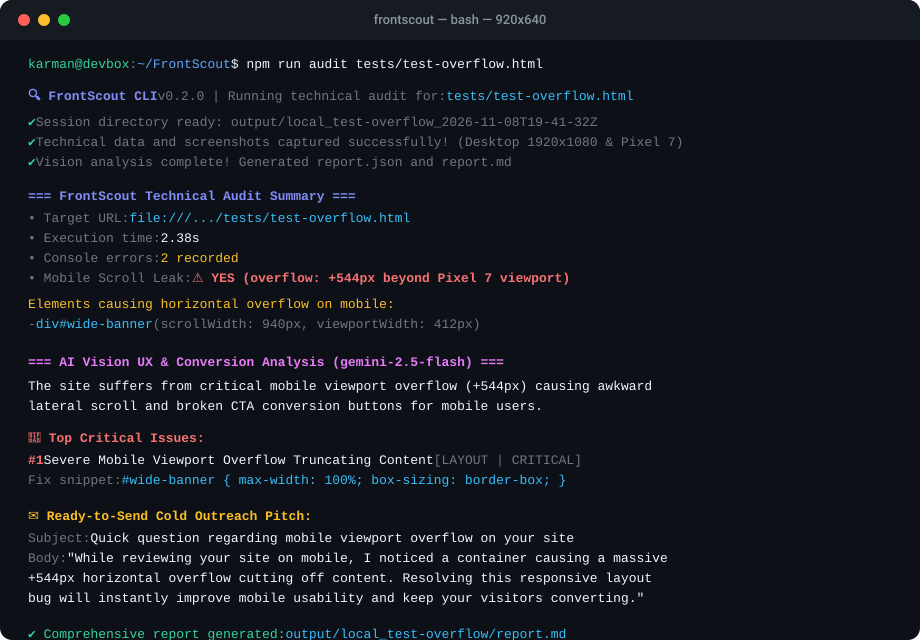

<div align="center">

# ⚡ FrontScout

**Autonomous Frontend & UX Audit Agent for High-Converting Cold Outreach**

[](https://github.com/Karman1818/FrontScout/actions/workflows/ci.yml)
[](tests/audit.test.ts)
[](https://www.typescriptlang.org/)
[](https://playwright.dev/)
[](https://nodejs.org/)
[](https://opensource.org/licenses/MIT)

<p align="center">
  <b>FrontScout</b> crawls target websites, catches runtime frontend glitches, identifies mobile layout overflows, captures high-res viewport proofs, and preps technical intelligence for Multimodal Vision LLMs to craft personalized outreach pitches.
</p>

<!-- Terminal Demo -->
<p align="center">
  
</p>

</div>

---

## 🎯 What is FrontScout?

Cold outreach to web design & dev prospects usually falls flat when using generic templates. **FrontScout** flips the script by turning automated, deep technical auditing into actionable value:

1. **Headless Diagnostics**: Simulates real Desktop (`1920x1080`) and Mobile (`Pixel 7`) environments.
2. **Deep Runtime Observation**: Intercepts unhandled JS errors, console logs, and failed HTTP requests (`>= 400`).
3. **Responsive Defect Spotting**: Pinpoints mobile horizontal scrolling (`scrollWidth > viewportWidth`) and pinpoints the exact offending DOM elements.
4. **Visual Proof Capture**: Grabs both *above-the-fold* (immediate impression) and *full-page* screenshots.
5. **AI Vision Ready**: Emits clean, typed JSON data structured for Multimodal LLMs (Gemini 2.5 Flash / Pro) to formulate code fixes and tailored cold outreach copy.

---

## 🏗️ Architecture & Workflow

```text
               ┌───────────────────────┐
               │    Target Website     │
               └──────────┬────────────┘
                          │
            [ Playwright Headless Engine ]
                          │
        ┌─────────────────┴─────────────────┐
        ▼                                   ▼
 [ Desktop Context ]                 [ Mobile Context ]
  - 1920x1080 Viewport                - Pixel 7 Emulation
  - Fold & Full Screenshot            - Fold & Full Screenshot
  - Console & HTTP Siphon             - Horizontal Scroll Detector
        │                                   │
        └─────────────────┬─────────────────┘
                          │
                          ▼
            [ Diagnostic Aggregator ]
            - Filters network failures (>= 400)
            - Traces DOM overflow culprits
            - Records uncaught page exceptions
                          │
                          ▼
            [ Multimodal Vision LLM ]
            - Inspects captured screenshots
            - Identifies CRO friction & UX flaws
            - Proposes concrete CSS/JS code fixes
            - Formulates tailored cold outreach pitch
                          │
                          ▼
           [ output/<session>/ ]
           ├── screenshots/*.png
           ├── technical-audit.json
           ├── report.json
           └── report.md
```

---

## ✨ Features

- 🖥️ **Dual Viewport Emulation**: Seamless Desktop & Mobile sessions with isolated browser contexts and touch simulation.
- 🚨 **Network & Console Siphon**: Automatically tracks `404s`, missing assets, API failures (`5xx`), and runtime JS errors with stack traces and source locations.
- 📐 **Mobile Horizontal Overflow Engine**: Identifies viewport leaks where elements break container bounds, calculating overflow pixels and CSS selectors.
- 📸 **High-Definition Screenshotting**: Captures both above-the-fold and full-height page renders.
- ⚡ **Zero-Config Developer Experience**: Run instantly with `npx tsx` or build with standard TypeScript.
- 🎨 **Sleek CLI Terminal UI**: Colored terminal output, interactive spinners, and structured metric summaries powered by `chalk` and `ora`.
- 🤖 **Vision LLM Integration**: Multimodal analysis generating executive summaries, code patches, and personalized cold outreach emails.

---

## 📋 Sample Audit Report

Every audit run generates a complete, executive-ready report in both Markdown (`report.md`) and JSON (`report.json`).

👉 **[View the complete sample audit report: `examples/sample-audit-report.md`](examples/sample-audit-report.md)**

### Excerpt from Generated Report:

> #### 🚨 Top Critical Issue #1: Mobile Horizontal Viewport Overflow on Hero Carousel
> - **Category:** `LAYOUT` | **Severity:** `CRITICAL`
> - **Business & CRO Impact:** Mobile users experience awkward horizontal scrolling, resulting in immediate bounce and abandoned browsing sessions.
> - **Technical Proof:** `.promo-slider-container` has an absolute width of `550px` inside a `412px` mobile device viewport (Pixel 7).
> - **Proposed Code Fix:**
> ```css
> .promo-slider-container {
>   width: 100%;
>   max-width: 100vw;
>   overflow-x: hidden;
>   box-sizing: border-box;
> }
> ```
>
> #### ✉️ Ready-to-Send Cold Outreach Pitch:
> **Subject:** *Quick note regarding mobile checkout friction on fashion-boutique-demo.pl*  
> *"Hi Team, while reviewing your store, I noticed that on mobile devices, the main promotional hero banner overflows 142px beyond the screen edge, pushing the primary checkout CTA off-screen and forcing awkward horizontal scrolling. I put together a quick technical audit with viewport screenshots and a clean 3-line CSS fix that resolves it immediately. Would you be open to checking out the full report?"*

---

## 🚀 Getting Started

### Prerequisites
- **Node.js**: v18.0.0 or higher
- **npm** or **pnpm** / **yarn**

### Installation

```bash
# Clone the repository
git clone https://github.com/Karman1818/FrontScout.git
cd FrontScout

# Install project dependencies
npm install

# Install Playwright browser binaries (Chromium)
npx playwright install chromium

# Copy and configure environment variables
cp .env.example .env
# Add your GEMINI_API_KEY to .env (optional, enables Multimodal Vision CRO reports)
```

---

## 💻 Usage

### Run an Audit

Audit any website using the `npm run audit` script:

```bash
# Audit a live website
npm run audit https://example.com

# Audit a local test file
npm run audit tests/test-overflow.html

# Technical-only audit (skipping AI Vision)
npm run audit https://example.com -- --skip-ai
```

Or invoke the CLI directly:

```bash
npx tsx src/audit.ts https://example.com
```

### CLI Options

```text
Usage: frontscout [options] <url>

FrontScout - Autonomous frontend & UX website audit agent

Arguments:
  url                 Target website URL to audit (e.g., example.com or local file)

Options:
  -o, --output <dir>  Path to output directory (default: "output")
  -t, --timeout <ms>  Max page navigation timeout in ms (default: "30000")
  --skip-ai           Skip AI Vision analysis and only perform technical Playwright audit (default: false)
  -h, --help          display help for command
```

### Example Terminal Output

```text
🔍 FrontScout CLI v0.2.0 | Running technical audit for: https://fashion-boutique-demo.pl
✔ Session directory ready: output/fashion-boutique-demo.pl_2026-11-08T19-30-00-000Z
✔ Technical data and screenshots captured successfully!
✔ Vision analysis complete! Generated report.json and report.md

=== FrontScout Technical Audit Summary ===
  • Target URL: https://fashion-boutique-demo.pl
  • Final URL: https://fashion-boutique-demo.pl/
  • Execution time: 3.84s
  • Console errors (console.error): 0
  • Unhandled JS exceptions (pageerror): 0
  • HTTP network errors (>= 400): 0
  • Mobile Horizontal Scroll: YES (overflow: +142px)

  Elements causing horizontal overflow on mobile:
    - div.promo-slider-container (scrollWidth: 554px, viewport: 412px)

Captured screenshots:
  • Desktop Viewport:   output/.../screenshots/desktop-fold.png
  • Desktop FullPage:   output/.../screenshots/desktop-full.png
  • Mobile Viewport:    output/.../screenshots/mobile-fold.png
  • Mobile FullPage:    output/.../screenshots/mobile-full.png

=== AI Vision UX & Conversion Analysis (gemini-2.5-flash) ===
The site suffers from critical mobile viewport overflow (+142px) caused by an unconstrained promotional hero slider...

🚨 Top Critical Issues:
  #1 Mobile Horizontal Viewport Overflow on Hero Carousel [LAYOUT | CRITICAL]
     Impact: Mobile users experience awkward horizontal scrolling, resulting in bounce.
     Fix snippet: .promo-slider-container { width: 100%; max-width: 100vw; ... }

✉️  Outreach Email Icebreaker:
  Subject: Quick note regarding mobile checkout friction on fashion-boutique-demo.pl
  Body:    "While reviewing your store, I noticed that on mobile devices..."

✔ Comprehensive report generated: output/.../report.md
```

---

## 📂 Output Structure

Audits are stored in timestamped session folders:

```text
output/
└── <domain_timestamp>/
    ├── screenshots/
    │   ├── desktop-fold.png      # Desktop above-the-fold viewport (1920x1080)
    │   ├── desktop-full.png      # Desktop full-page document capture
    │   ├── mobile-fold.png       # Mobile above-the-fold viewport (Pixel 7)
    │   └── mobile-full.png       # Mobile full-page document capture
    ├── technical-audit.json      # Structured telemetry (logs, DOM leaks, HTTP)
    ├── report.json               # Typed JSON audit report from Multimodal LLM
    └── report.md                 # Executive Markdown report ready for client presentation
```

---

## 🧪 Automated Testing Suite (10 Tests)

FrontScout includes a robust automated test suite built on Node's native `node:test` runner. The suite executes in **< 100ms** with zero external network or browser dependencies, ensuring lightning-fast CI runs.

```bash
# Run the test suite
npm test
```

### Test Coverage Highlights:
1. `normalizeUrl`: Prepending protocol and resolving relative file paths to `file://` URLs.
2. `sanitizeHostname`: Extracting clean domain identifiers and subdomains across URL variants.
3. `sanitizeHostname`: Handling `file://` protocols and fallbacks on malformed URLs.
4. `saveJsonFile` & `prepareAuditDirectory`: Ephemeral directory generation and JSON serialization.
5. `buildVisionPrompt`: Formatting telemetry, culprit elements, and HTTP/Console errors into the Vision prompt.
6. `buildVisionPrompt`: Clean baseline handling when zero defects are detected.
7. `generateMarkdownReport`: Markdown generation with executive summaries, code fixes, and outreach pitches.
8. `generateMarkdownReport`: Graceful handling of empty issues lists.
9. `generateJsonReport`: Type-safe serialization of `FinalAuditReport`.
10. `layout telemetry aggregator`: Validating layout overflow computations and element culprit structures.

---

## ⚙️ CI/CD (GitHub Actions)

Continuous Integration is configured via [`.github/workflows/ci.yml`](.github/workflows/ci.yml). Every push and pull request executes:
- Multi-version Node.js matrix testing (`Node 20.x` & `Node 22.x` on `ubuntu-latest`).
- Clean package dependency installation (`npm ci`).
- Automated test suite execution (`npm test`).
- Full TypeScript typecheck and build validation (`npm run build`).

---

## 🛠️ How I Built It (Engineering & AI Collaboration)

> *Recruiter & Technical Deep-Dive: A transparent breakdown of the development process, balancing AI-assisted acceleration with hands-on systems engineering, architecture, and manual verification.*

### 1. AI Tooling Utilized
* **Cursor / Claude 3.5 Sonnet & Gemini 2.5 Pro**: Used for rapid architectural ideation, TypeScript interface boilerplate (`src/types/`), regex generation, and drafting preliminary prompt scaffolding.
* **Google Gemini Multimodal Vision (`@google/genai` - `gemini-2.5-flash`)**: The core analytical engine driving the runtime audit, correlating headless browser telemetry with above-the-fold screenshots to diagnose CRO bottlenecks and frontend defects.

### 2. What I Engineered & Manually Refactored After AI:

While LLMs are fantastic for boilerplate generation, building a production-grade CLI agent required extensive hands-on debugging, manual refactoring, and custom engineering:

#### 📐 A. Accurate Horizontal Scroll & Viewport Leak Detection (`src/collectors/layout.ts`)
* **The AI Limitation:** Initial LLM suggestions relied on naive standard checks like `document.body.scrollWidth > window.innerWidth`. In modern React, Next.js, and Tailwind applications utilizing `overflow-x: clip`, sticky navigation, or positioned containers, this produced recurring false positives or completely missed clipped subtrees.
* **The Custom Solution:** Engineered a custom Playwright evaluation script (`page.evaluate`) that recursively inspects DOM subtree geometry (`getBoundingClientRect`), evaluates computed CSS layout properties (`overflow`, `position`, `visibility`, `display`), compares `visualViewport` vs `clientWidth`, and computes the exact CSS selector of the offending element causing viewport distortion.

#### 🌐 B. Hermetic Browser Contexts & Multi-Device Emulation (`src/collectors/playwright.ts`)
* **The AI Limitation:** AI prototypes created a single shared browser context for both Desktop and Mobile passes. This resulted in state pollution, shared cookies, session storage leakage, and cache artifacts distorting mobile screenshots.
* **The Custom Solution:** Architected isolated, ephemeral browser contexts separating Desktop (`1920x1080`) and Mobile (Pixel 7 emulation with simulated touch events, DPR 2.625, and isolated cookies/cache), guaranteeing clean cache boundaries, zero state leakage, and authentic viewport rendering.

#### 🎯 C. Multimodal Vision Prompt Conditioning & Anti-Hallucination Guardrails (`src/analyzers/`)
* **The AI Limitation:** Early unconstrained LLM prompts yielded generic, generic SEO fluff ("add alt text to your images", "improve contrast").
* **The Custom Solution:** Implemented strict JSON schema enforcement (`responseMimeType: 'application/json'`) and conditioned the LLM prompt directly on verified Playwright telemetry (exact culprit CSS selectors, overflow pixel counts, console logs, and HTTP error codes). The LLM is strictly constrained to output concrete business CRO impact, technical proof, and runnable CSS/JS code fixes.

#### 🛡️ D. Defensive Runtime Resilience & Graceful Degradation (`src/audit.ts`)
* **The AI Limitation:** Naive code paths crashed the entire process whenever a target website emitted unexpected runtime exceptions or when the LLM API experienced rate limits.
* **The Custom Solution:** Designed an error-resilient aggregator that categorizes runtime failures without crashing the reporting pipeline. If AI Vision analysis fails (or the user provides no API key), FrontScout gracefully falls back to technical Playwright diagnostics and saves `technical-audit.json`.

#### ⚡ E. Zero-External-Dependency Fast Test Suite (`tests/audit.test.ts`)
* **The AI Limitation:** AI suggested end-to-end integration tests that launched full browser instances inside CI for every test case, requiring 500MB browser downloads and causing flakiness in cloud runners.
* **The Custom Solution:** Architected a 10-test suite leveraging Node's native `node:test` runner with mock telemetry and hermetic file fixtures, running in **< 100ms** and eliminating browser download overhead in GitHub Actions.

---

## 📄 License

This project is licensed under the [MIT License](LICENSE).
